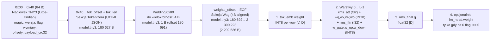

# Format binarny TNY3 (`.tny3`)

> Część dokumentacji systemu Tiny: [← Powrót do głównego przewodnika](./TINY_SYSTEM_DOCUMENTATION.md)  
> Powiązane dokumenty: [Architektura i Tokenizer](./TINY_ARCHITECTURE.md) · [Matematyka operacji](./TINY_MATHEMATICS.md) · [Silnik i KV Cache](./TINY_RUNTIME.md) · [Przenośność](./TINY_SYSTEM_DOCUMENTATION.md#rozdział-x--przenośność-i-integracja-z-zewnętrznymi-aplikacjami)

---

## ROZDZIAŁ IV – Format binarny `.tny3`

Źródła analizowane bezpośrednio w tym rozdziale: `export_tny3.py` (`602` linie, szczególnie linie `26–189` i `197–433`) oraz `parseTNY3()` w `tartarus-engine.ts:201–374`.

### 1. Dlaczego własny format binarny zamiast JSON lub `.pt` (PyTorch)?

- **Poziom A (intuicyjny):** Plik treningowy PyTorcha (`checkpoints/best.pt`, `26.01 MB`) zawiera nie tylko wagi modelu, ale też stan optymalizatora AdamW (kolejne miliony liczb z treningu) i jest zapisany w formacie *Python Pickle*, którego nie da się bezpiecznie ani łatwo otworzyć w przeglądarce bez całego PyTorcha. Z kolei zapis wag jako zwykły tekst (JSON) powiększyłby plik kilkukrotnie i spowolnił odczyt. Format `.tny3` pakuje **w jednym zwartym pliku binarnym** zarówno słownik (tokenizer), jak i skompresowane do `INT8` wagi oraz instrukcję wymiarów modelu – tak, żeby dowolny program mógł go wczytać w kilkadziesiąt milisekund z pełną kontrolą sumy kontrolnej.
- **Poziom B (techniczny):** **POTWIERDZONE** — Plik `.tny3` (`model.tny3` dla Profilu `S`: `2 390 228 B` = `2.28 MiB`; `/tmp/model_m.tny3` dla Profilu `M`: `5 309 908 B` = `5.06 MiB`) składa się z trzech ciągłych bloków w porządku **Little-Endian**:
  1. Stałego **64-bajtowego nagłówka** (`HEADER_STRUCT = <4s2H6I2f4I2I`).
  2. Sekcji **konfiguracji tokenizera** zakodowanej w `UTF-8 JSON` i dopełnionej bajtami `0x00` do wielokrotności `4` bajtów.
  3. Sekcji **skwantowanych wag** w ustalonej, kanonicznej kolejności tensorów.
- **Poziom C:** W przeglądarce plik wczytywany jest bezpośrednio do jednego bufora `ArrayBuffer`, a parser `parseTNY3()` (`tartarus-engine.ts:201–374`) czyta go bez żadnych bibliotek zewnętrznych przy użyciu standardowego `DataView`, `Uint8Array` i `Int8Array`.

---

### 2. Diagram rozmieszczenia danych w pliku `.tny3`

---

### 3. Tabela wszystkich pól 64-bajtowego nagłówka (`HEADER_STRUCT`)

**POTWIERDZONE** — Kolejność, typy i bajty ustalone bezpośrednio na podstawie `export_tny3.py:80` (`struct.Struct("<4s2H6I2f4I2I")`) oraz `tartarus-engine.ts:212–288`.

| Offset (hex / dec) | Pole | Typ (LE) | Rozmiar | Znaczenie | Walidacja w `parseTNY3()` (`tartarus-engine.ts`) |
| --- | --- | --- | --- | --- | --- |
| `0x00` (`0`) | `magic` | `4 × char` (`4s`) | `4 B` | Identyfikator formatu (`"TNY3"`) | `raw[0..3]` musi równać się `"TNY3"` (`L212–215`) |
| `0x04` (`4`) | `format_version` | `uint16` (`H`) | `2 B` | Wersja specyfikacji binarnej (`1`) | Musi być `=== 1` (`L217–220`) |
| `0x06` (`6`) | `flags` | `uint16` (`H`) | `2 B` | Maska bitowa cech architektury (`0b101 = 5`) | Sprawdza bity `1` i `2` (`L222–232`, patrz sekcja flag poniżej) |
| `0x08` (`8`) | `vocab_size` | `uint32` (`I`) | `4 B` | Rozmiar słownika (`2048`) | Musi być `> 0` oraz równy `tokenizer.vocabSize` (`L249, L292`) |
| `0x0C` (`12`) | `ctx_len` | `uint32` (`I`) | `4 B` | Maksymalna długość kontekstu `CTX` (`256`) | Musi być `> 0` (`L249`) |
| `0x10` (`16`) | `d_model` | `uint32` (`I`) | `4 B` | Wymiar ukryty modelu (`192` dla S, `256` dla M) | `> 0`, `dModel % nHeads === 0`, `dModel % 4 === 0` (`L249–261`) |
| `0x14` (`20`) | `n_layers` | `uint32` (`I`) | `4 B` | Liczba bloków Transformer (`4` dla S, `6` dla M) | Musi być `> 0` (`L249`) |
| `0x18` (`24`) | `n_heads` | `uint32` (`I`) | `4 B` | Liczba głowic Attention (`6` dla S, `8` dla M) | `> 0`, `dModel % nHeads === 0`, `(dModel/nHeads) % 2 === 0` (`L252–258`) |
| `0x1C` (`28`) | `d_ff` | `uint32` (`I`) | `4 B` | Wymiar warstwy ukrytej SwiGLU (`512` dla S, `640` dla M) | `> 0` oraz `dFf % 4 === 0` (`L249, L259`) |
| `0x20` (`32`) | `rope_theta` | `float32` (`f`) | `4 B` | Podstawa częstotliwości RoPE (`10000.0`) | Odczytane bezpośrednio przez `dv.getFloat32(32, true)` (brak walidacji `> 0` w `parseTNY3` — **OGRANICZENIE**) |
| `0x24` (`36`) | `norm_eps` | `float32` (`f`) | `4 B` | Stała $\varepsilon$ w `RMSNorm` (`1e-5`, w f32 `~9.9999997e-6`) | Odczytane przez `dv.getFloat32(36, true)` (brak walidacji `> 0` w `parseTNY3` — **OGRANICZENIE**) |
| `0x28` (`40`) | `tok_offset` | `uint32` (`I`) | `4 B` | Początek sekcji JSON tokenizera (`64`) | Musi być `=== 64` oraz `tokOffset % 4 === 0` (`L262–264`) |
| `0x2C` (`44`) | `tok_len` | `uint32` (`I`) | `4 B` | Dokładna długość UTF-8 JSON tokenizera (`180 627` B) | Spójność przez `weightsOffset >= tokOffset + tokLen` (`L265`) |
| `0x30` (`48`) | `weights_offset` | `uint32` (`I`) | `4 B` | Początek sekcji wag (`180 692`) | `weightsOffset % 4 === 0` oraz `>= tokOffset + tokLen` (`L265–267`) |
| `0x34` (`52`) | `weights_len` | `uint32` (`I`) | `4 B` | Rozmiar sekcji wag w bajtach (`2 209 536` dla S) | `weightsOffset + weightsLen === totalByteLength` i wyczerpanie kursora (`L268–272, L351`) |
| `0x38` (`56`) | `payload_crc32` | `uint32` (`I`) | `4 B` | Suma kontrolna IEEE 802.3 CRC-32 bajtów `[64 .. EOF)` | `computeCrc32(raw.subarray(64)) === payloadCrc32` (`L280–285`) |
| `0x3C` (`60`) | `reserved` | `uint32` (`I`) | `4 B` | Pole zarezerwowane na przyszłość (`0`) | Odczytywane i zapisywane do `header.reserved` (nie blokuje odczytu, jeśli różne od 0) |

**Suma rozmiarów:** `4 + 2 + 2 + 6×4 + 2×4 + 4×4 + 2×4 = 64 B` (`0x40`).

---

### 4. Flagi bitowe (`flags`, offset `0x06`)

**POTWIERDZONE** (`export_tny3.py:83–86`, `tartarus-engine.ts:23–25, 222–232`):

| Bit | Maska | Stała | Znaczenie `0` | Znaczenie `1` | Wymaganie aktualnego silnika |
| --- | --- | --- | --- | --- | --- |
| Bit `0` | `1 << 0` (`1`) | `FLAG_TIED_EMBEDDINGS` | Osobny tensor `lm_head.weight` na końcu sekcji wag | `lm_head` współdzielony z `tok_emb` | Obsługuje `0` i `1` (`tartarus-engine.ts:342–348`), choć eksportowane modele mają `1` |
| Bit `1` | `1 << 1` (`2`) | `FLAG_ROPE_INTERLEAVED` | Konwencja RoPE **half-split** | Konwencja RoPE **interleaved** | **Wymagane `0`**; bit `1 == 1` rzuca `Error` (`L227–229`) |
| Bit `2` | `1 << 2` (`4`) | `FLAG_SWIGLU` | Brak SwiGLU | Warstwa MLP typu **SwiGLU** | **Wymagane `1`**; bit `2 == 0` rzuca `Error` (`L230–232`) |

W obu zweryfikowanych plikach (`model.tny3` i `/tmp/model_m.tny3`) pole `flags` wynosi `5` (`0b101` = `tied_embeddings=true`, `rope=half-split`, `swiglu=true`).

---

### 5. Wyrównanie danych (4-byte alignment) i padding

- **Poziom A:** Procesory i widoki binarne w pamięci (`DataView`, `Float32Array`) wymagają lub pracują najbezpieczniej wtedy, gdy 4-bajtowe liczby `float32` leżą pod adresami podzielnymi przez `4`. Ponieważ tekst JSON tokenizera może mieć dowolną długość w bajtach (np. `180 627` bajtów, co daje koniec na offsecie `64 + 180 627 = 180 691`), po nim dopisuje się od `0` do `3` zerowych bajtów wypełnienia (*padding*), aby sekcja wag zaczęła się dokładnie na granicy podzielnej przez `4`.
- **Poziom B/C:** **POTWIERDZONE** —
  1. W `export_tny3.py:89–90, 221`: `align4(n) = (n + 3) & ~3`. Dla `tok_offset = 64` i `tok_len = 180 627`:
     `weights_offset = align4(64 + 180627) = align4(180691) = 180692` (`180692 % 4 = 0`), a `tok_pad_len = 180692 - 180691 = 1 B` (`0x00`).
  2. W `parseTNY3()` (`tartarus-engine.ts:274–278`) każdy bajt w przedziale `[tokOffset + tokLen, weightsOffset)` jest sprawdzany — jakikolwiek niezerowy bajt w paddingu powoduje odrzucenie pliku błędem.
  3. **Wyrównanie wewnątrz sekcji wag:** Każdy wektor `float32` ma rozmiar `4 * D` (podzielny przez `4`), a każdy wiersz macierzy `INT8` ma rozmiar `4 + cols` bajtów (`4 B` na `float32 scale` + `cols B` na wartości `int8`). Ponieważ wagi `D` oraz `d_ff` spełniają `D % 4 == 0` i `d_ff % 4 == 0`, **każdy pojedynczy wiersz każdej macierzy ma rozmiar podzielny przez 4** i leży pod adresem podzielnym przez 4!
  4. **Szczegół techniczny Node `Buffer`:** W `parseTNY3()` funkcja `readVectorF32(dv, cursor, length)` korzysta z `dv.getFloat32(offset + i * 4, true)`, co działa niezależnie od przesunięcia `baseByteOffset` całego przekazanego bufora (np. wspólnego slaba pamięci w Node.js `Buffer`), natomiast `new Int8Array(buffer, baseByteOffset + cursor + 4, cols)` ma wyrównanie elementu `1 B`, więc jest zawsze bezpieczne.

---

### 6. Suma kontrolna CRC-32

- **POTWIERDZONE** — Suma kontrolna IEEE 802.3 (`0xEDB88320`, wielomian odwrócony) w `computeCrc32()` (`tartarus-engine.ts:132–150`) liczona jest dokładnie nad obszarem `raw[64 .. EOF)` (czyli całą sekcją tokenizera, paddingiem i sekcją wag — identycznie jak `zlib.crc32(payload) & 0xFFFFFFFF` w `export_tny3.py:242`).
- **Co chroni:** wykrywa każde przerwanie pobierania pliku, obcięcie końcówki lub losowe przekłamanie bitu w sekcji tokenizera lub wag. **OGRANICZENIE:** Sama zmiana bajtu *wewnątrz* pierwszych 64 bajtów nagłówka (np. ręczna modyfikacja pola `reserved`) nie zmienia `payload_crc32`, ale modyfikacja offsetów/rozmiarów jest wychwytywana przez asercje spójności rozmiaru lub magic/version.

---

### 7. Dokładne rozmieszczenie wag i rozmiar sekcji wag

**POTWIERDZONE** (`export_tny3.py:167–189`, `tartarus-engine.ts:296–353`):

Sekcja wag zaczyna się pod `weights_offset` (`180 692`) i zawiera tensory w ścisłej, niezmiennej kolejności (w pliku nie ma nazw tensorów — parser zna układ wyłącznie po wymiarach z nagłówka):

1. `tok_emb.weight`: macierz INT8 `[vocab_size, d_model]` (`V × (4 + D)` B)
2. Dla każdej warstwy `l = 0 .. n_layers - 1`:
   - `blocks.{l}.rms_att.g`: wektor `float32[d_model]` (`4 × D` B)
   - `blocks.{l}.wq.weight`: macierz INT8 `[d_model, d_model]` (`D × (4 + D)` B)
   - `blocks.{l}.wk.weight`: macierz INT8 `[d_model, d_model]` (`D × (4 + D)` B)
   - `blocks.{l}.wv.weight`: macierz INT8 `[d_model, d_model]` (`D × (4 + D)` B)
   - `blocks.{l}.wo.weight`: macierz INT8 `[d_model, d_model]` (`D × (4 + D)` B)
   - `blocks.{l}.rms_ffn.g`: wektor `float32[d_model]` (`4 × D` B)
   - `blocks.{l}.w_gate.weight`: macierz INT8 `[d_ff, d_model]` (`d_ff × (4 + D)` B)
   - `blocks.{l}.w_up.weight`: macierz INT8 `[d_ff, d_model]` (`d_ff × (4 + D)` B)
   - `blocks.{l}.w_down.weight`: macierz INT8 `[d_model, d_ff]` (`D × (4 + d_ff)` B)
3. `rms_final.g`: wektor `float32[d_model]` (`4 × D` B)
4. *Opcjonalnie* (gdy `(flags & 1) === 0`): `lm_head.weight`: macierz INT8 `[vocab_size, d_model]`.

**Zweryfikowane rozmiary rzeczywistych plików:**
- **Profil `S` (`model.tny3`):** `64 + 180 627 + 1 + 2 209 536 = 2 390 228 B` (`2.28 MiB`), gdzie jedna warstwa zajmuje `453 440 B`, cztery warstwy `1 813 760 B`, `tok_emb` `401 408 B` (`2048 × 196`), `rms_final` `768 B`, `CRC-32 = 0x938fb800`.
- **Profil `M` (`/tmp/model_m.tny3`):** `64 + 180 627 + 1 + 5 129 216 = 5 309 908 B` (`5.06 MiB`), gdzie jedna warstwa zajmuje `765 568 B`, sześć warstw `4 593 408 B`, `tok_emb` `532 480 B` (`2048 × 260`), `rms_final` `1 024 B`, `CRC-32 = 0x389121a9`.

---

### 8. Konsekwencje trybu W8A32 oraz przenośność formatu

1. **Zalety W8A32 (INT8 na dysku → Float32Array przy ładowaniu):**
   - **Mały plik na dysku / szybkie pobranie w sieci:** Wagi zajmują ok. `1/4` rozmiaru pełnego `float32` (`2.11 MiB` wag dla Profilu `S` zamiast `8.26 MiB` przed kompresją).
   - **Prosta i szybka matematyka w JavaScript:** W przeglądarce nie trzeba dekwantować wag w każdej milisekundzie pętli podczas mnożenia macierzy (co przy W8A8/W8A32 *on-the-fly* wymagałoby mnożenia przez `scale` wewnątrz każdego wiersza przy każdym tokenie). Zamiast tego wagi stają się od razu natywną tablicą `Float32Array` przy otwarciu pliku (`~29–48 ms` w Node.js dla Profilu `S`).
   - **Znikoma strata jakości względem treningowego modelu z kwantyzacją:** Różnica funkcji straty między `FLOAT` a `INT8` po 160 krokach wyniosła `+0.0009` (`5.7904` vs `5.7913`, `checkpoints/train_history.json`), a pomiędzy odczytanymi wagami z `.tny3` a `quantized_copy` w PyTorch `max_weight_diff = 0.00e+0` (`golden_test.json:33–35`).
2. **Koszty W8A32:**
   - Zużycie pamięci RAM w trakcie działania jest **ok. 3.9× większe** niż rozmiar pliku na dysku (`8.26 MiB` dla wag + `1.50 MiB` dla KV Cache w Profilu `S`, czyli ok. `9.83 MiB` struktur numerycznych zamiast `2.28 MiB`). Przy znacznie większych modelach (np. setki milionów parametrów) konieczna byłaby dekwantyzacja w locie lub WebGPU.
3. **Przenośność formatu vs przenośność silnika:**
   - **Przenośność formatu `.tny3`:** Format jest całkowicie samoopisowy dla każdego środowiska potrafiącego czytać bajty Little-Endian i JSON UTF-8 (`Python`, `TypeScript/JS`, `C/C++`, `Rust`, `C#`, `WebAssembly`). Nie wymaga bibliotek ML ani schematów protobuf/safetensors, a pełna definicja tokenizera BPE znajduje się w środku samego pliku, więc **nie trzeba wysyłać osobno pliku `tokenizer.json`**.
   - **Przenośność silnika `tartarus-engine.ts`:** To z kolei konkretna implementacja runtime’u dla środowisk JavaScript/TypeScript (przeglądarka, Web Worker, Node.js, Deno/Bun). Więcej w [Rozdziale X](./TINY_SYSTEM_DOCUMENTATION.md#rozdział-x--przenośność-i-integracja-z-zewnętrznymi-aplikacjami).
