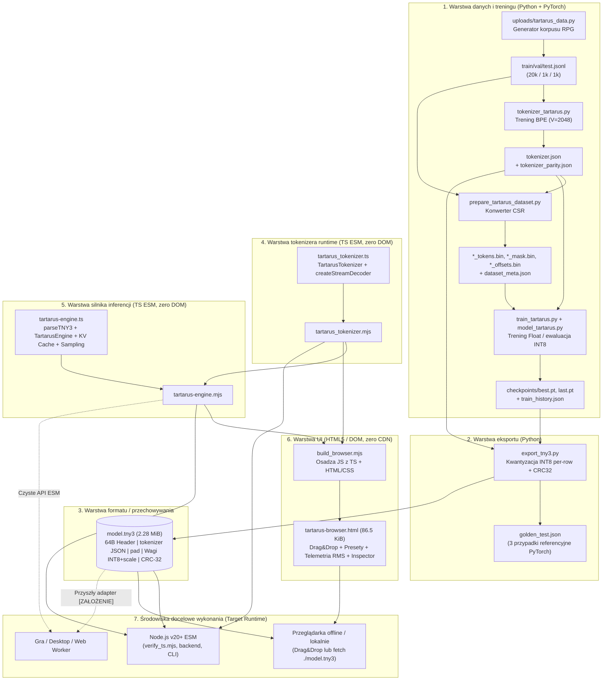

# Dokumentacja Techniczna, Edukacyjna i Referencyjna Projektu Tiny (Tartarus)

**Wersja dokumentacji:** Stan przestrzeni roboczej na dzień `2026-11-24` (po zakończeniu Etapów 1–5)  
**Cel dokumentu:** Umożliwienie właścicielowi projektu pełnego zrozumienia każdego mechanizmu, odtworzenia architektury po dłuższej przerwie oraz samodzielnej weryfikacji pracy przyszłych agentów wyłącznie na podstawie zweryfikowanych faktów z plików projektu.

---

## Legenda statusów stosowanych w całej dokumentacji

Każde istotne twierdzenie w całej dokumentacji posiada jeden z poniższych tagów statusu:

- **`[POTWIERDZONE]`** – fakt potwierdzony bezpośrednim odczytem plików źródłowych, analizą binarną (`model.tny3`, `/tmp/model_m.tny3`) lub uruchomionym testem (`verify_tokenizer.mjs`, `verify_ts.mjs`, `tsc`, symulacja `vm.Script` na `tartarus-browser.html`).
- **`[ZAIMPLEMENTOWANE]`** – mechanizm zapisany w kodzie źródłowym, którego składnia jest poprawna, ale dla którego nie wykonano pełnego testu przekrojowego lub w docelowym środowisku (np. w prawdziwej przeglądarce z silnikiem Chromium).
- **`[ZAŁOŻENIE PROJEKTOWE]`** – decyzja architektoniczna, wariant użycia lub propozycja integracji niewymuszona twardym testem uruchomieniowym.
- **`[NIEZWERYFIKOWANE]`** – obszar niesprawdzony w tym środowisku (np. pełny trening 20 epok na GPU CUDA, prawdziwy render w Chrome/Firefox, zużycie pamięci w realnej przeglądarce).
- **`[OGRANICZENIE]`** – twarde ograniczenie obecnej implementacji, formatu lub obecnych wag modelu.
- **`[DO WYJAŚNIENIA]`** – element niejednoznaczny lub brakujący w stosunku do pierwotnych nazw/oczekiwań (np. nazwy historycznych plików UI nieobecnych w katalogu).

---

## Spis treści całej dokumentacji (moduły powiązane)

Dokumentacja składa się z głównego przewodnika (niniejszy plik) oraz 7 specjalistycznych plików w katalogu `docs/`:

1. **Przewodnik główny (`TINY_SYSTEM_DOCUMENTATION.md`)**
   - [Rozdział I – Historia i ogólna architektura Tiny](#rozdział-i--historia-i-ogólna-architektura-tiny)
   - [Rozdział X – Przenośność i integracja z zewnętrznymi aplikacjami](#rozdział-x--przenośność-i-integracja-z-zewnętrznymi-aplikacjami)
   - [Rozdział XII – Ograniczenia, ryzyka i dalsza walidacja](#rozdział-xii--ograniczenia-ryzyka-i-dalsza-walidacja)
   - [Mapa Kodu (Code Map) – pełny indeks plików i tabela funkcji](#mapa-kodu)
   - [Lista kontrolna do weryfikacji pracy agentów (10 pytań)](#lista-kontrolna-do-weryfikacji-pracy-agentów-10-pytań)
2. **[Architektura modelu i Tokenizacja](./TINY_ARCHITECTURE.md)**
   - [Rozdział II – Podstawy działania modelu (w zestawieniu 1:1 z Tiny)](./TINY_ARCHITECTURE.md#rozdział-ii--podstawy-działania-modelu-w-zestawieniu-11-z-tiny)
   - [Rozdział III – Tokenizer (`tartarus_tokenizer.ts` i zgodność z Pythonem)](./TINY_ARCHITECTURE.md#rozdział-iii--tokenizer-tartarus_tokenizerts-i-zgodność-z-pythonem)
3. **[Matematyka operacji na trzech poziomach](./TINY_MATHEMATICS.md)**
   - [Reprezentacja danych i precyzja](./TINY_MATHEMATICS.md#1-reprezentacja-danych-wektory-macierze-i-precyzja-liczb), [INT8 W8A32](./TINY_MATHEMATICS.md#2-kwantyzacja-i-dekwantyzacja-int8-per-row-w8a32), [RMSNorm](./TINY_MATHEMATICS.md#3-normalizacja-rmsnorm-eps--1e-5), [RoPE half-split](./TINY_MATHEMATICS.md#4-pozycyjne-osadzenia-obrotowe-rope-konwencja-half-split), [Attention](./TINY_MATHEMATICS.md#5-multi-head-causal-self-attention-q-k-v), [SwiGLU](./TINY_MATHEMATICS.md#6-warstwa-mlp-z-bramką-swiglu), [Logity](./TINY_MATHEMATICS.md#7-końcowe-logity-i-tied-embeddings) i [Sampling](./TINY_MATHEMATICS.md#8-matematyka-samplingu-wybór-kolejnego-tokenu) z ręcznymi obliczeniami na liczbach z Tiny.
4. **[Format binarny TNY3 (`.tny3`)](./TINY_FORMAT_TNY3.md)**
   - [Rozdział IV – 64-bajtowy nagłówek, flagi, alignment, CRC-32, kolejność tensorów i konsekwencje W8A32](./TINY_FORMAT_TNY3.md#rozdział-iv--format-binarny-tny3)
5. **[Silnik inferencji, KV Cache, Sampling, UI i Wydajność](./TINY_RUNTIME.md)**
   - [Rozdział V – Silnik inferencji TypeScript (`tartarus-engine.ts`)](./TINY_RUNTIME.md#rozdział-v--silnik-inferencji-typescript--javascript-tartarus-enginets)
   - [Rozdział VI – KV Cache](./TINY_RUNTIME.md#rozdział-vi--kv-cache)
   - [Rozdział VII – Sampling i generowanie tekstu](./TINY_RUNTIME.md#rozdział-vii--sampling-i-generowanie-tekstu)
   - [Rozdział IX – Interfejs przeglądarkowy (`tartarus-browser.html`)](./TINY_RUNTIME.md#rozdział-ix--interfejs-przeglądarkowy-tartarus-browserhtml-i-build_browsermjs)
   - [Rozdział XI – Wydajność i pamięć (Node.js vs przeglądarka)](./TINY_RUNTIME.md#rozdział-xi--wydajność-i-pamięć)
6. **[Weryfikacja matematyczna i testy](./TINY_TESTS.md)**
   - [Rozdział VIII – Test referencyjny PyTorch (`golden_test.json`), wyniki `verify_ts.mjs` i granice dowodów](./TINY_TESTS.md#rozdział-viii--weryfikacja-matematyczna)
7. **[Słownik pojęć (46+ haseł)](./TINY_GLOSSARY.md)**
   - Każde pojęcie wytłumaczone prostym językiem, technicznie i na konkretnym przykładzie z plików projektu.
8. **[Ścieżka nauki właściciela projektu (12 etapów)](./TINY_LEARNING_PATH.md)**
   - Praktyczny przewodnik krok po kroku od katalogu z plikami do diagnozowania błędów, bez wymogu znajomości programowania.

---

## ROZDZIAŁ I – Historia i ogólna architektura Tiny

### 1. Skąd się wziął projekt i do czego ma służyć?

- **Poziom A (intuicyjnie):** Projekt **Tiny** (wewnętrzna nazwa w plikach kodu: **Tartarus**) powstał jako kompletny, własny rurociąg do stworzenia małego modelu językowego dla polskiej gry RPG. Zamiast łączyć się z chmurą i płacić za zewnętrzne API, gracz lub aplikacja dostaje mały plik modelu (`~2.3 MiB` dla Profilu `S` lub `~5.1 MiB` dla Profilu `M`), który potrafi działać lokalnie — w przeglądarce albo w Node.js — bez żadnych zewnętrznych bibliotek.
- **Poziom B (technicznie):** `[POTWIERDZONE]` Projekt zrealizowano w pięciu wyraźnie oddzielonych etapach:
  1. **Etap 1 (`uploads/tartarus_data.py`):** wygenerował syntetyczny polski korpus dialogów i zapytań o stan gry RPG (`train.jsonl` = `20 000` rekordów, `val.jsonl` = `1 000`, `test.jsonl` = `1 000`, brak duplikatów/przecieków między splitami) w ujednoliconym formacie `<|state|> ... <|user|> ... <|npc|> ... <|eos|>`.
  2. **Etap 2 (`tokenizer_tartarus.py`, `prepare_tartarus_dataset.py`, `tartarus_tokenizer.ts`):** wytrenował deterministyczny tokenizer Byte-Level BPE o słowniku `2048` tokenów (`tokenizer.json`), zapisał dane treningowe w binarnym formacie CSR (`tartarus-csr-v1`) i wdrożył bliźniaczy tokenizer TypeScript z testem zgodności 1:1 (`tokenizer_parity.json`, `verify_tokenizer.mjs`).
  3. **Etap 3 (`model_tartarus.py`, `train_tartarus.py`):** zdefiniował architekturę Transformer (stylem zbliżoną do LLaMA: `RoPE half-split`, `RMSNorm`, brak biasu, `SwiGLU`, `tied embeddings`) w dwóch profilach rozmiarowych (`S`: `2,164,416` parametrów; `M`: `5,049,600` parametrów) oraz pętlę treningu z dwutorową ewaluacją Float vs symulowany `INT8`. Na tym środowisku bez GPU przeprowadzono wyłącznie krótki próbny trening CPU na `160` kroków (`checkpoints/best.pt`).
  4. **Etap 4 (`export_tny3.py`):** wprowadził kompaktowy kontener binarny `TNY3` (`model.tny3` o rozmiarze `2 390 228 B`, wagi skwantyzowane symetrycznie per-wiersz do `INT8`, wbudowany JSON tokenizera oraz suma `CRC-32`) i wygenerował plik wzorców liczbowych PyTorch (`golden_test.json`).
  5. **Etap 5 (`tartarus-engine.ts`, `verify_ts.mjs`, `build_browser.mjs`, `tartarus-browser.html`):** dostarczył czysty, pozbawiony zależności od DOM silnik inferencji w ścisłym TypeScript ES2022 z prealokowanym KV Cache i samplingiem, zweryfikowany bitowo/numerycznie przeciwko PyTorch (`maxAbs = 2.146e-6`) oraz spakowany przez `build_browser.mjs` do jednego niezależnego pliku przeglądarkowego `tartarus-browser.html` (`88 592 B`).

- **Poziom C (granica tego, co istnieje w projekcie):** `[POTWIERDZONE]` Cała infrastruktura od generacji korpusu do silnika wykonawczego w przeglądarce i Node.js **istnieje i została zweryfikowana pod kątem zgodności matematycznej oraz technicznej**. `[OGRANICZENIE]` Natomiast same obecne wagi w `model.tny3` pochodzą ze wspomnianego testowego uruchomienia na `160` kroków na 2-rdzeniowym CPU (`val_loss_float = 5.7904`, `val_loss_int8 = 5.7913`) — oznacza to, że **silnik liczy dokładnie tak samo jak PyTorch**, ale model w `model.tny3` **nie przeszedł jeszcze pełnego treningu na GPU** (szczegóły w [Rozdziale XII](#rozdział-xii--ograniczenia-ryzyka-i-dalsza-walidacja)).

### 2. Diagram przepływu danych i podział na 7 warstw systemu

Poniższy diagram rozdziela wyraźnie środowisko fabryki (Python, tworzenie modelu) od środowiska docelowego wykonania (TS/JS bez Pythona i bez zewnętrznych pakietów):



### 3. Przewodnik po rozdziałach szczegółowych

Zamiast powielać obszerne analizy w jednym pliku, szczegółowe rozdziały są zgrupowane tematycznie w pozostałych plikach dokumentacji:

- **Jak model reprezentuje słowa i z jakich bloków się składa:** [Rozdział II](./TINY_ARCHITECTURE.md#rozdział-ii--podstawy-działania-modelu-w-zestawieniu-11-z-tiny)
- **Jak działa tokenizer BPE i obsługa polskich znaków UTF-8:** [Rozdział III](./TINY_ARCHITECTURE.md#rozdział-iii--tokenizer-tartarus_tokenizerts-i-zgodność-z-pythonem)
- **Jak wyglądają wzory RMSNorm, RoPE, Attention, SwiGLU i kwantyzacji z obliczeniami ręcznymi:** [Matematyka Tiny](./TINY_MATHEMATICS.md)
- **Jak zbudowany jest plik binarny `.tny3` bajt po bajcie:** [Rozdział IV](./TINY_FORMAT_TNY3.md#rozdział-iv--format-binarny-tny3)
- **Jak zbudowany jest silnik TypeScript (`TartarusEngine`) i jak działają metody `prefill`, `step`, `forwardNoCache`:** [Rozdział V](./TINY_RUNTIME.md#rozdział-v--silnik-inferencji-typescript--javascript-tartarus-enginets)
- **Jak działa prealokowany KV Cache `L × CTX × D`:** [Rozdział VI](./TINY_RUNTIME.md#rozdział-vi--kv-cache)
- **Jak wybierane są tokeny (`greedy`, `temperature`, `topK`, `minP`, `repetitionPenalty`) i warunki końca:** [Rozdział VII](./TINY_RUNTIME.md#rozdział-vii--sampling-i-generowanie-tekstu)
- **Jak przeprowadzono weryfikację przeciwko PyTorch (`2.146e-6`, `0.000e+0`) i czego te testy nie dowodzą:** [Rozdział VIII](./TINY_TESTS.md#rozdział-viii--weryfikacja-matematyczna)
- **Jak działa interfejs `tartarus-browser.html` i co należy do UI, a co do silnika:** [Rozdział IX](./TINY_RUNTIME.md#rozdział-ix--interfejs-przeglądarkowy-tartarus-browserhtml-i-build_browsermjs)
- **Ile dokładnie pamięci RAM zajmują Profile `S` i `M` oraz jak szybki był silnik w Node.js:** [Rozdział XI](./TINY_RUNTIME.md#rozdział-xi--wydajność-i-pamięć)

---

## ROZDZIAŁ X – Przenośność i integracja z zewnętrznymi aplikacjami

### 1. Niezależność od przeglądarki i zerowe zależności (`ES2022 ESM`)

- **Poziom A (intuicyjnie):** Silnik Tiny został napisany tak, jak dobrze odizolowany moduł biblioteczny w C: nie zakłada, że działa na stronie WWW. Nie szuka przycisków, okna przeglądarki ani nie pobiera paczek z internetu. Dopóki środowisko potrafi wykonywać nowoczesny JavaScript (`ES2022`) i ma podstawowe typy `ArrayBuffer`, `Float32Array` oraz `TextEncoder`/`TextDecoder`, silnik się uruchomi.
- **Poziom B (technicznie):** `[POTWIERDZONE]` Konfiguracja `tsconfig.json:2–15` wymusza:
  - `"lib": ["ES2022"]` — **brak `DOM`** w tablicy `lib`! Gdyby jakikolwiek fragment `tartarus_tokenizer.ts` lub `tartarus-engine.ts` odwołał się do `document`, `window` lub `HTMLElement`, kompilacja `tsc` zakończy się błędem kompilacji.
  - `"types": []` — zero niejawnych typów `@types/node`; oba pliki źródłowe nie używają `node:fs`, `node:path` ani `require`.
  - `"module": "ES2022"` i `"strict": true` — czyste moduły ES (`import`/`export`) zweryfikowane przez `npx -y -p typescript tsc --ignoreConfig --noEmit --strict --target ES2022 --module ES2022 --lib ES2022 tartarus_tokenizer.ts tartarus-engine.ts`.
  - Jedyna różnica środowiskowa (`performance.now()` vs `Date.now()` w `nowMs()`, `tartarus-engine.ts:126–130`; `globalThis.TextEncoder` / `globalThis.TextDecoder` w `tartarus_tokenizer.ts:43–51` i `tartarus-engine.ts:120–124`) sprawdzana jest bezpiecznie przez `globalThis` bez twardych odwołań do obiektów Node ani przeglądarki.
  - `[POTWIERDZONE]` Jedyna modyfikacja wykonana pod łączenie w jeden skrypt (`EngineTextDecoderCtor` w `tartarus-engine.ts:120`) zapobiegła kolizji nazw podczas konkatenacji obu plików w IIFE wewnątrz `tartarus-browser.html`.

### 2. Scenariusze osadzenia silnika w docelowych aplikacjach

| Środowisko docelowe | Sposób integracji z Tiny | Status / Uwagi praktyczne |
| :--- | :--- | :--- |
| **A. Przeglądarka / nowoczesna strona WWW (React, Vue, Vite, czysty HTML ESM)** | `<script type="module">` albo import z bundlera:<br>`import { TartarusEngine } from "./tartarus-engine.mjs";`<br>`const buf = await (await fetch("./model.tny3")).arrayBuffer();`<br>`const engine = TartarusEngine.fromArrayBuffer(buf);` | `[POTWIERDZONE]` Działa z surowego pliku `.mjs` bez kroków transpilacji; `tartarus_tokenizer.mjs` musi leżeć obok `./tartarus-engine.mjs` (import względny w `tartarus-engine.ts:12`). |
| **B. Web Worker w przeglądarce** | Uruchomienie `TartarusEngine` wewnątrz `new Worker("worker.mjs", { type: "module" })`. Wysłanie `ArrayBuffer` przez *Transferable* (`postMessage(buf, [buf])`) bez kopiowania bajtów; odsyłanie kolejnych `ev.textDelta` przez `postMessage`. | `[ZAŁOŻENIE PROJEKTOWE]` Zalecane dla płynności animacji 60 FPS w grach WebGL/HTML5, bo `prefill` blokuje jeden wątek przez ~`200+ ms` (zależnie od sprzętu). Niezaimplementowane jeszcze w `tartarus-browser.html`. |
| **C. Node.js (serwer API, CLI, bot, testy automatyczne)** | `import fs from "node:fs";`<br>`import { TartarusEngine } from "./tartarus-engine.mjs";`<br>`const engine = TartarusEngine.fromArrayBuffer(fs.readFileSync("./model.tny3"));` | `[POTWIERDZONE]` W Node `Buffer` dziedziczy po `Uint8Array` (spełnia `ArrayBufferView`), ale ma niezerowe `byteOffset` z puli — `parseTNY3()` poprawnie to obsługuje (`tartarus-engine.ts:174, 203`). Wymagany Node.js `v18+` (testowano na `v20.20.2`), w `package.json` (lub przez rozszerzenie `.mjs`) musi być tryb ESM. |
| **D. Gra lub aplikacja desktopowa (Electron, Tauri, Godot/Unity/C++/C#)** | 1) **Electron / Tauri / Node-API:** bezpośredni import `tartarus-engine.mjs` w procesie JS lub Workerze.<br>2) **Silnik natywny (C++ / Rust / C#):** albo przez osadzony most JS/WebView/lokalne RPC do procesu Node/Deno, albo przez przepisanie parsera `TNY3` i 600 linii pętli matematycznych na natywny kod (np. w C++/Rust bez alokacji, korzystając z identycznego formatu `model.tny3`). | `[ZAŁOŻENIE PROJEKTOWE]` Format `TNY3` jest banalny do odczytania w dowolnym języku z `stdint.h`, ale obecna implementacja w repozytorium istnieje wyłącznie w Pythonie (`export_tny3.py` loader) i TypeScript (`tartarus-engine.ts`). |

### 3. Co należy do gry Tartarus, a co jest ogólnym silnikiem Transformer?

Oddzielenie warstwy uniwersalnej od domeny RPG ułatwia użycie silnika nawet w innym projekcie tekstowym:

1. **Część 100% uniwersalna (niezależna od RPG):**
   - Format binarny `TNY3` (nagłówek, flagi, wbudowany słownik BPE, wagi INT8 per-row, suma `CRC-32`).
   - Klasa `TartarusTokenizer` (ogólny tokenizer Byte-Level BPE z obsługą dowolnej listy `special_tokens` zapisanej w konfiguracji JSON) — jedyny drobny detal specyficzny dla projektu to pretokenizacyjny regex `PRETOKENIZE_SOURCE` w `tartarus_tokenizer.ts:62`, który musi zgadzać się z tym użytym przy treningu tokenizera.
   - Cały silnik `TartarusEngine` (`parseTNY3`, `rmsNormInto`, `matVecInto`, `applyRopeHalfSplitInPlace`, `silu`, `kCache`/`vCache`, `prefill`, `step`, `forwardNoCache`, `sampleNextToken`) — jest to generyczny silnik dekoderowego Transformera o dowolnych wymiarach `V, CTX, D, L, H, d_ff` zapisanych w nagłówku `.tny3` (z ograniczeniem do aktywnych cech z nagłówka, zob. Rozdział XII).

2. **Część specyficzna dla projektu Tartarus / gry RPG:**
   - Zestaw 5 tokenów specjalnych `<|pad|>`, `<|eos|>`, `<|state|>`, `<|user|>`, `<|npc|>` i kontrakt promptu `format_record` (`uploads/tartarus_data.py:1445`).
   - W `tartarus-engine.ts:462–466` pola pomocnicze `padId`, `eosId`, `stateId`, `userId`, `npcId` pobierane są po nazwie przez `getSpecialId(...) ?? 0..4`. Nawet gdyby ktoś użył własnych tagów w innym `.tny3`, zadziała wszystko poza wartościami domyślnymi w tych 5 polach (`eosId` wpływa na `stopOnEos` w `generateStream`).
   - W `build_browser.mjs` / `tartarus-browser.html`: całe formularze UI (`Stan gry`, `Pytanie gracza`, lista `PRESETS`, podgląd `buildPromptString()`).

3. **Jak czysto oddzielić logikę gry od samego silnika:**
   - Gra nigdy nie powinna dotykać `kCache`, `logits` ani składać ręcznie surowych tokenów wewnątrz pętli Render/Update gry.
   - Gra utrzymuje obiekt stanu świata (HP, złoto, jednostki, tura), warstwa **adaptera domenowego** serializuje go do jednego napisu formatu `<|state|> ... <|user|> ... <|npc|>`, sprawdza zawczasu `engine.encode(prompt).length < engine.header.ctxLen`, a następnie konsumuje `generateStream()` zwracając grze tekst i kod zakończenia.

### 4. Przykładowy projekt API do integracji zewnętrznej `[ZAŁOŻENIE PROJEKTOWE]`

> **Uwaga:** Poniższy interfejs to **propozycja projektowa (szablon kontraktu)** do przyszłego użycia przez integratora — **nie istnieje** w obecnych plikach repozytorium i nie został zaimplementowany ani przetestowany. Pokazuje, jak cienką warstwę adaptera należałoby dopisać bez ruszania `tartarus-engine.ts`.

```ts
// [ZAŁOŻENIE PROJEKTOWE] Przykładowy adapter dla zewnętrznej gry / aplikacji
import { TartarusEngine, type GenerateOptions, type GenerateResult } from "./tartarus-engine.mjs";

export interface GameStateSnapshot {
  location: string;
  hp: number;
  maxHp: number;
  gold: number;
  units: string;
  extraFields?: Record<string, string | number>;
}

export interface NpcReply {
  text: string;
  stoppedBy: "eos" | "ctx" | "max_tokens";
  promptTokensCount: number;
  generatedTokensCount: number;
  latencyMs: number;
}

export class TinyGameAdapter {
  private readonly engine: TartarusEngine;

  private constructor(engine: TartarusEngine) {
    this.engine = engine;
  }

  public static fromTny3Buffer(buffer: ArrayBuffer | ArrayBufferView): TinyGameAdapter {
    return new TinyGameAdapter(TartarusEngine.fromArrayBuffer(buffer));
  }

  public formatPrompt(state: GameStateSnapshot, userQuestion: string): string {
    const parts = [
      `lokacja=${state.location}`,
      `hp=${state.hp}/${state.maxHp}`,
      `złoto=${state.gold}`,
      `jednostki=${state.units}`,
    ];
    if (state.extraFields) {
      for (const [k, v] of Object.entries(state.extraFields)) {
        parts.push(`${k}=${v}`);
      }
    }
    return `<|state|> ${parts.join("; ")} <|user|> ${userQuestion.trim()} <|npc|>`;
  }

  public canFitPrompt(state: GameStateSnapshot, userQuestion: string, minAnswerTokens = 16): boolean {
    const ids = this.engine.encode(this.formatPrompt(state, userQuestion));
    return ids.length + minAnswerTokens <= this.engine.header.ctxLen;
  }

  public askNpc(
    state: GameStateSnapshot,
    userQuestion: string,
    sampling: GenerateOptions = { temperature: 0.25, topK: 32, minP: 0.06, repetitionPenalty: 1.15, maxNewTokens: 96 }
  ): NpcReply {
    const prompt = this.formatPrompt(state, userQuestion);
    const res: GenerateResult = this.engine.generate(prompt, sampling);
    return {
      text: res.text.trim(),
      stoppedBy: res.stoppedBy,
      promptTokensCount: res.promptTokens.length,
      generatedTokensCount: res.generatedTokens.length,
      latencyMs: res.prefillMs + res.decodeMs,
    };
  }
}
```

---

## ROZDZIAŁ XII – Ograniczenia, ryzyka i dalsza walidacja

Ta sekcja oddziela rzetelnie to, co projekt **udowodnił**, od tego, co jest **tylko kodem lub wymaga dalszej pracy**, zanim ktokolwiek wdroży model w prawdziwej grze.

### 1. Podsumowanie statusów kluczowych elementów systemu

| Obszar / Twierdzenie | Status | Szczegóły z weryfikacji w przestrzeni roboczej |
| :--- | :--- | :--- |
| Zgodność tokenizera Python ↔ TypeScript (`119` testów + `2000` rekordów `val`/`test`) | `[POTWIERDZONE]` | `verify_tokenizer.mjs`: `119/119` (`1000/1000` val, `1000/1000` test), `0` błędów. |
| Bezstratny UTF-8 streaming polskich znaków rozciętych przez BPE | `[POTWIERDZONE]` | Zweryfikowano na `"Świętogora"` → `[202, 159, 809, 819]` oraz w `verify_ts.mjs`. |
| Kontrakt binarny `TNY3` (`parseTNY3`, walidacja nagłówka, alignment, odrzucenie uszkodzonego `CRC-32`) | `[POTWIERDZONE]` | `model.tny3` (`2 390 228 B`, `0x938fb800`) + `/tmp/model_m.tny3` (`5 309 908 B`, `0x389121a9`) + test mutacji 1 bitu w `verify_ts.mjs`. |
| Równoważność matematyczna PyTorch ↔ TS (`forwardNoCache`, `prefill`, `step`) | `[POTWIERDZONE]` | `verify_ts.mjs`: `maxAbs <= 2.146e-6 < 1e-4` na `3/3` przypadkach w `golden_test.json`; `KV Cache vs NoCache = 0.000e+0`; 16 kroków `maxΔ = 0.00e+0`. |
| Brak alokacji obiektów pamięci w gorącej pętli dekodowania (`step`) | `[POTWIERDZONE]` | Ręczny przegląd `tartarus-engine.ts:570–711` + przyrost sterty w benchmarku `10×64` zaledwie `404.5 KiB` w Node.js. |
| Przenośność czystego kodu ES2022 bez DOM | `[POTWIERDZONE]` | `tsc --ignoreConfig --noEmit --strict --target ES2022 --module ES2022 --lib ES2022` zakończony kodem `0`. |
| Działanie logiki UI `tartarus-browser.html` na obu profilach (`S` i `M`) i blokadzie `CTX` | `[POTWIERDZONE CZĘŚCIOWO]` | Zweryfikowano w Node.js przy użyciu `vm.Script` i mockowanego DOM (`S` `L=4`, `M` `L=6`, `LIMIT CTX!`), ale **bez prawdziwej przeglądarki Chromium/Firefox**. |
| Prawdziwy render UI (CSS, układ, obsługa myszy/Drag&Drop w Chrome/Firefox/Edge) | `[NIEZWERYFIKOWANE]` | W tym sandboxie brak przeglądarki Chromium i Playwrighta — wygląd i zdarzenia GUI nie przeszły realnego renderu w przeglądarce. |
| Jakość merytoryczna odpowiedzi modelu i jego wartość użytkowa w grze | `[OGRANICZENIE]` / `[NIEZWERYFIKOWANE]` | Obecne wagi (`checkpoints/best.pt`, `model.tny3`) pochodzą z testu CPU na `160` kroków (epoka 1, `val_loss = 5.79`, `ppl = 327.1`). Model produkuje jeszcze słabe lub zmyślone odpowiedzi tekstowe. Pełny trening `train_tartarus.py` na GPU CUDA (`20` epok) **nie został wykonany**. |
| Obecność pliku `tiny-2.1-browser-v2.html` | `[DO WYJAŚNIENIA]` | Taki plik nie istnieje w katalogu `/home/user` (faktycznym wygenerowanym artefaktem Etapu 5 jest `/home/user/tartarus-browser.html`). |

### 2. Ryzyka i ograniczenia techniczne (do decyzji architektonicznych)

1. **Sztywne okno kontekstu `CTX = 256` bez mechanizmu okna przesuwnego (*sliding window*) i bez wieloturowej historii czatu:**
   - `[OGRANICZENIE]` Bufor `kCache`/`vCache` i tablice `RoPE` kończą się na pozycji `255`. Model jest trenowany do pojedynczego strzału `<|state|> ... <|user|> ... <|npc|> ... <|eos|>`, nie do zapamiętywania kilkunastu rund rozmowy. Jeśli gra wyśle bogatszy stan RPG (np. 15 jednostek i długi opis lokacji przekraczający `256` tokenów), silnik rzuci `RangeError`.
2. **Brak obsługi trybu `FLAG_ROPE_INTERLEAVED` w runtime:**
   - `[OGRANICZENIE]` Nagłówek `.tny3` ma bit `1 << 1` rezerwujący wariant naprzemiennego RoPE, ale zarówno `export_tny3.py:322`, jak i `tartarus-engine.ts:251` rzucają błąd, jeśli ten bit jest ustawiony.
3. **Narzucona konfiguracja W8A32 (zużycie RAM ~`4.3×` większe od rozmiaru pliku na dysku):**
   - `[OGRANICZENIE]` Dekwantyzacja do `Float32` przy wczytywaniu pliku upraszcza kod i daje bardzo mały rozrzut od PyTorcha, ale kosztuje RAM: dla Profilu `S` (`2.28 MiB` na dysku) sam silnik trzyma `9.84 MiB`, a dla Profilu `M` (`5.06 MiB` na dysku) już `22.35 MiB`. Gdyby w przyszłości powstał model np. `50M` parametrów, W8A32 zajęłoby w przeglądarce ~`200+ MiB` zamiast `50 MiB` — wówczas konieczne byłoby przejście na mnożenie w locie bezpośrednio na wagach `INT8` (*W8A8 / W8A32 fused matvec*).
4. **Jednowątkowość obliczeń JS w głównym wątku strony (`tartarus-browser.html`):**
   - `[OGRANICZENIE]` Chociaż w pętli dekodowania `runStreamingGeneration()` oddaje wątek przeglądarce po każdym tokenie przez `nextFrameYield()`, pierwszy krok `gen.next()` (`tartarus-browser.html:2233`) wykonuje synchroniczny `prefill()` dla wszystkich tokenów promptu naraz. W Node.js dla `77` tokenów było to ~`229 ms`; na wolnym telefonie w przeglądarce może to zauważalnie przyciąć interfejs na ułamek sekundy przy rozpoczęciu każdej odpowiedzi. Rozwiązaniem docelowym byłoby przeniesienie silnika do Web Workera.
5. **Wyłączone przetestowanie pełnego treningu GPU i stabilności długiego kontekstu dla Profilu `M`:**
   - `[NIEZWERYFIKOWANE]` Wprawdzie Profil `M` przeszedł weryfikację pliku `/tmp/model_m.tny3` (`CRC-32`, `prefill`, benchmark `118.8 tok/s` oraz symulację `vm.Script` w HTML), lecz dla Profilu `M` **nie wygenerowano** w przestrzeni roboczej osobnego pliku `golden_test_m.json` przeciwko PyTorch (wszystkie 3 przypadki `golden_test.json` w `/home/user` dotyczą Profilu `S`). Co więcej, `/tmp/model_m.tny3` leży w katalogu tymczasowym `/tmp`, poza głównym snapshotem workspace'u!
6. **Brak twardej weryfikacji spójności SHA-256 w runtime przy wczytywaniu `.tny3`:**
   - `[OGRANICZENIE]` Kontener `TNY3` bardzo dobrze chroni integralność bajtów przez `CRC-32`, a w `tartarus-engine.ts:346–352` sprawdza `tokHeader.vocabSize === header.vocabSize` i liczbę specjalnych tokenów. Sama procedura `parseTNY3()` nie sprawdza natomiast czy wagi były faktycznie trenowane z tym konkretnym `tokenizer.json` (tę kontrolę wykonuje jedynie etap treningu/eksportu w Pythonie przez `tokenizer_sha256` w checkpoincie `.pt` — po złożeniu w `.tny3` zakłada się, że eksporter spakował pasującą parę).
7. **Słownictwo i styl korpusu:**
   - `[OGRANICZENIE]` Cały model pochodzi z syntetycznego generatora szablonów RPG (`uploads/tartarus_data.py`), gdzie `max` długość sekwencji w zbiorach wynosi `154` (train), `192` (val) i `196` (test) tokenów (`dataset_meta.json`). Model nie ma wiedzy ogólnej spoza świata Tartarus/RPG i nawet po pełnym treningu nie będzie pełnił roli ogólnego czatbota.

### 3. Wieloobszarowy plan dalszej walidacji przed użyciem produkcyjnym

1. **Obszar A – Jakość modelu i pełny trening (Python + GPU CUDA):**
   - Wytrenować Profil `S` (i ewentualnie `M`) na GPU z pełnym harmonogramem (`--epochs 20`), obserwując zbieżność `val_loss_float` vs `val_loss_int8` w `checkpoints/train_history.json` oraz wskaźnik jakościowy z `train_tartarus.py --eval-only` (zgodność faktów liczbowych ze `<|state|>`, poprawne zamykanie `<|eos|>`).
   - Po eksporcie finalnego `model.tny3` (oraz ewentualnego `model_m.tny3`) wygenerować świeży `golden_test.json` i powtórzyć bramkę `verify_ts.mjs` na **docelowych wytrenowanych wagach**.
2. **Obszar B – Prawdziwe przeglądarki WWW (Chrome, Firefox, Safari/Edge, desktop + mobile):**
   - Otworzyć `tartarus-browser.html` przez lokalny serwer HTTP (`python3 -m http.server`) oraz z dysku (`file://`) w realnych przeglądarkach; sprawdzić automatyczne pobieranie (`./model.tny3`), Drag & Drop pliku `.tny3`, poprawność wykresów RMS, responsywność suwaków i przycisku `Przerwij` podczas długiego streamu.
3. **Obszar C – Testy graniczne, błędy i długotrwała stabilność:**
   - Sprawdzić zachowanie przy promptach długości dokładnie `255` tokenów (`255 + 1 = 256`, 1 wolny slot), `256` tokenów (odrzucenie), promptach pustych, niepoprawnych plikach (zły nagłówek, skrócony plik, uszkodzone `CRC-32`, inny `vocabSize`) oraz przy kilkudziesięciu generacjach z rzędu (obserwacja zużycia pamięci zakładki w DevTools Memory Profiler przez kilka minut).
4. **Obszar D – Pomiar docelowej wydajności (profiling TTFT i `tok/s` na sprzęcie gracza):**
   - Osobno zmierzyć w docelowej przeglądarce czas `prefill` (Time To First Token – TTFT) dla typowego promptu `80–150` tokenów oraz `tok/s` dla dekodowania. Jeśli na urządzeniu docelowym `prefill` przekroczy akceptowalny próg (np. zamraża animację >50 ms), przenieść `TartarusEngine` do Web Workera.
5. **Obszar E – Testy integracji w zewnętrznej aplikacji:**
   - Przy podłączeniu do gry przetestować kontrakt adaptera: czy przekroczenie budżetu `CTX` jest obsługiwane przez skracanie opisu stanu gry *przed* wywołaniem silnika, a wyjście po `<|npc|>` jest odporne na sytuacje brzegowe (`stoppedBy === "ctx"` lub `"max_tokens"` bez końcowej kropki).

---

## Mapa Kodu

### A. Pełny spis plików projektu w `/home/user`

#### 1. Warstwa danych, tokenizera treningowego i datasetu CSR (Etap 1–2)
| Plik | Rozmiar | Linii | Rola i zawartość |
| :--- | ---: | ---: | :--- |
| `uploads/tartarus_data.py` | `106 926 B` | `1713` | Generator syntetycznego polskiego korpusu RPG (jednostki, lokacje, zaklęcia, stany, dialogi, pytania o stan, lore, odmowy) z podziałem bez przecieków. |
| `train.jsonl` | `7 640 394 B` | `20 000` rec. | Zbiór treningowy w formacie JSONL (pola rekordów i tekst `<|state|>...<|user|>...<|npc|>...`). |
| `val.jsonl` | `378 094 B` | `1 000` rec. | Zbiór walidacyjny do pomiaru `val_loss` i prób jakościowych. |
| `test.jsonl` | `396 756 B` | `1 000` rec. | Zbiór testowy (nieużywany do treningu). |
| `tokenizer_tartarus.py` | `53 955 B` | `1248` | Trener Byte-Level BPE, ewaluator słowników, konwerter CSR, generator `tokenizer_parity.json`. |
| `prepare_tartarus_dataset.py` | `3 071 B` | `77` | Skrypt CLI wywołujący `encode_dataset_csr` i `verify_csr_dataset` na splitach `train`/`val`/`test`. |
| `tokenizer.json` | `381 048 B` | `28385` | Wyeksportowany słownik `tartarus-bpe-v1` (`V=2048`, `5` tokenów specjalnych, `256` bajtów, `1787` scaleń BPE). |
| `tokenizer_parity.json` | `88 365 B` | `4161` | `119` przypadków testowych (teksty + `expected_ids` z Pythona) do testów zgodności 1:1 w TS. |
| `dataset_meta.json` | `4 290 B` | `146` | Manifest `tartarus-csr-v1`: typy danych (`<u2`, `u1`, `<u8`), SHA-256 plików i statystyki długości sekwencji. |
| `train_{tokens,mask,offsets}.bin` | `3 027 680` / `1 513 840` / `160 008 B` | bin. | Spakowany zbiór treningowy CSR (`1 513 840` tokenów, maska uczenia `0` na prompt i `1` na odpowiedź). |
| `val_{tokens,mask,offsets}.bin` | `229 334` / `114 667` / `8 008 B` | bin. | Spakowany zbiór walidacyjny CSR (`114 667` tokenów). |
| `test_{tokens,mask,offsets}.bin` | `240 614` / `120 307` / `8 008 B` | bin. | Spakowany zbiór testowy CSR (`120 307` tokenów). |

#### 2. Warstwa modelu, treningu i eksportu `.tny3` (Etap 3–4)
| Plik | Rozmiar | Linii | Rola i zawartość |
| :--- | ---: | ---: | :--- |
| `model_tartarus.py` | `22 071 B` | `552` | Definicja `TartarusConfig` (`S`/`M`), `RMSNorm`, `precompute_rope_tables`, `apply_rope_half_split`, `KVCache`, `TartarusBlock`, `TartarusModel`, `self_test()`. |
| `train_tartarus.py` | `32 359 B` | `750` | Pętla treningowa PyTorch (bucket batching z CSR `memmap`, AdamW, cosine LR, `quantized_copy()`, eval jakościowy, CLI `--eval-only`). |
| `checkpoints/best.pt` | `26 010 421 B` | bin. | Checkpoint Profilu `S` po próbnym treningu `160` kroków CPU (zawiera wagi modelu + stan optymalizatora AdamW). |
| `checkpoints/last.pt` | `26 010 421 B` | bin. | Ostatni checkpoint z kroku `160` (identyczny w tym przebiegu z `best.pt`). |
| `checkpoints/train_history.json` | `960 B` | `38` | Historia ewaluacji z kroku `80` (`val_loss=5.8894`) i `160` (`val_loss=5.7904`). |
| `export_tny3.py` | `26 052 B` | `602` | Kwantyzacja wag do `INT8` per-row, eksporter `export_model_tny3`, loader `load_tny3` w Pythonie i generator `golden_test.json`. |
| `model.tny3` | `2 390 228 B` | bin. | Gotowy binarny artefakt Profilu `S` (`CRC32=0x938fb800`). |
| `/tmp/model_m.tny3` | `5 309 908 B` | bin. | Tymczasowy binarny artefakt testowy Profilu `M` (`CRC32=0x389121a9`, poza trwałym `/home/user`). |
| `golden_test.json` | `182 843 B` | `6503` | `3` przypadki testowe Profilu `S` z pełnymi `2048` logitami referencyjnymi z PyTorcha. |

#### 3. Warstwa runtime TypeScript, kompilacji, testów i UI (Etap 2 i 5)
| Plik | Rozmiar | Linii | Rola i zawartość |
| :--- | ---: | ---: | :--- |
| `tsconfig.json` | `460 B` | `19` | Konfiguracja TypeScript `ES2022` ESM (`strict: true`, `lib: ["ES2022"]`, `types: []` — zero DOM). |
| `tartarus_tokenizer.ts` | `10 710 B` | `339` | Tokenizer runtime w TypeScript + dekoder strumieniowy UTF-8. |
| `tartarus_tokenizer.{js,mjs,d.ts}` | `10 103` / `10 103` / `1 792 B` | `254` / `48` | Skompilowane moduły ESM tokenizera i deklaracje typów. |
| `tartarus-engine.ts` | `33 726 B` | `1033` | Parser `.tny3` (`parseTNY3`), silnik inferencji (`TartarusEngine`), KV Cache i sampling. |
| `tartarus-engine.{js,mjs,d.ts}` | `32 388` / `32 389` / `5 991 B` | `784` / `157` | Skompilowane moduły ESM silnika i deklaracje typów (`.mjs` jest plikiem wykonywanym bezpośrednio w Node). |
| `verify_tokenizer.ts` | `4 786 B` | `123` | Skrypt weryfikacji tokenizera napisany w TypeScript. |
| `verify_tokenizer.mjs` | `6 198 B` | `158` | Test zgodności Python ↔ JS na `119` parach z `tokenizer_parity.json` i `2000` rekordach `val`/`test`. |
| `verify_ts.mjs` | `13 422 B` | `318` | Zestaw bramek Etapu 5 (ładowanie `.tny3`, CRC-32, golden parity, 16-step KV, streaming, CTX, benchmark `10×64`). |
| `build_browser.mjs` | `47 604 B` | `1417` | Skrypt Node.js sklejający `tartarus_tokenizer.js` + `tartarus-engine.js` z szablonem HTML/CSS/UI. |
| `tartarus-browser.html` | `88 592 B` | `2415` | Samowystarczalna strona HTML działająca offline (UI demonstracyjne z wbudowanym silnikiem). |

#### 4. Warstwa dokumentacji (`docs/`)
| Plik | Zawartość |
| :--- | :--- |
| `docs/TINY_SYSTEM_DOCUMENTATION.md` | Główny przewodnik (Spis treści, Legenda, Rozdziały I, X, XII, Mapa Kodu, Checklist 10 pytań). |
| `docs/TINY_ARCHITECTURE.md` | Rozdział II (LLM i Transformer w Tiny) oraz Rozdział III (Tokenizer BPE i UTF-8). |
| `docs/TINY_MATHEMATICS.md` | 3-poziomowa matematyka Tiny z obliczeniami ręcznymi (W8A32, RMSNorm, RoPE, Attention, SwiGLU, Sampling). |
| `docs/TINY_FORMAT_TNY3.md` | Rozdział IV (Format binarny `.tny3`, 64B nagłówek, flagi, alignment, CRC-32, wagi). |
| `docs/TINY_RUNTIME.md` | Rozdziały V, VI, VII, IX, XI (Silnik TS, KV Cache, Sampling, UI przeglądarkowe, Wydajność i RAM). |
| `docs/TINY_TESTS.md` | Rozdział VIII (Weryfikacja matematyczna `golden_test.json`, wyniki i granice testów). |
| `docs/TINY_GLOSSARY.md` | Słownik `46+` kluczowych terminów na trzech poziomach wyjaśnienia. |
| `docs/TINY_LEARNING_PATH.md` | 12-etapowa praktyczna ścieżka nauki dla właściciela projektu. |

---

### B. Mapa wywołań: `Funkcja / Klasa → Plik → Linie → Wejścia → Wyjścia → Zależności`

#### 1. Warstwa Runtime: `tartarus_tokenizer.ts` (`339` linii)
| Nazwa funkcji / metody | Zakres linii | Wejście | Wyjście | Zależności |
| :--- | :--- | :--- | :--- | :--- |
| `escapeRegex(literal)` | `L53–55` | `literal: string` | `string` (bezpieczny wzorzec RegExp) | Brak |
| `TartarusTokenizer.constructor(config)` | `L72–163` | `config: TartarusTokenizerConfig` | Instancja tokenizera z mapami bajtów, ranków BPE i specjalnym RegExp | `RuntimeTextEncoder`, `RuntimeTextDecoder`, `escapeRegex`, `PAIR_STRIDE` |
| `getSpecialId(token)` / `getSpecialToken(id)` | `L165–171` | `token: string` / `id: number` | `number \| undefined` / `string \| undefined` | `specialToId`, `idToSpecial` |
| `getTokenBytes(id)` | `L173–178` | `id: number` | `Uint8Array` | `tokenBytes[id]` |
| `createStreamDecoder(options?)` | `L180–202` | `{skipSpecial?, skipPad?}` | `{ push(id): string, flush(): string }` | `TextDecoder(..., { stream: true })`, `idToSpecial` |
| `encodeChunk(chunk)` (private) | `L204–237` | `chunk: string` | `readonly number[]` (ID tokenów BPE) | `textEncoder`, `mergeRanks`, `PAIR_STRIDE`, `byteOffset` |
| `encode(text)` | `L259–294` | `text: string` | `number[]` | `specialRegex`, `pretokenRegex`, `encodeChunk` |
| `decode(ids, options?)` | `L296–338` | `ids: Iterable<number>`, `DecodeOptions?` | `string` (UTF-8) | `textDecoder`, `tokenBytes`, `idToSpecial` |

#### 2. Warstwa Runtime: `tartarus-engine.ts` (`1033` linii)
| Nazwa funkcji / metody | Zakres linii | Wejście | Wyjście | Zależności |
| :--- | :--- | :--- | :--- | :--- |
| `nowMs()` | `L126–130` | Brak | `number` (czas w ms) | `globalThis.performance` lub `Date.now` |
| `computeCrc32(bytes)` | `L144–150` | `bytes: Uint8Array` | `number` (unsigned 32-bit CRC) | `CRC32_TABLE` (`L132–142`) |
| `readVectorF32(dv, offset, length)` | `L152–165` | `DataView`, `offset: number`, `length: number` | `{ vec: Float32Array, nextOffset: number }` | `DataView.getFloat32` |
| `readMatrixInt8Dequant(buf, baseOff, dv, off, rows, cols)` | `L167–199` | `ArrayBuffer`, przesunięcia, wymiary | `{ weights: Float32Array, nextOffset: number }` | `DataView.getFloat32`, `Int8Array` |
| `parseTNY3(input)` | `L201–381` | `ArrayBuffer \| ArrayBufferView` | `ParsedTNY3` (`header`, `tokenizer`, `weights`) | `computeCrc32`, `TartarusTokenizer`, `readVectorF32`, `readMatrixInt8Dequant` |
| `rmsNormInto(out, x, xOff, g, dim, eps)` | `L383–400` | Bufory `Float32Array`, przesunięcie, `dim`, `eps` | Zapis w miejscu do `out` | `Math.sqrt` |
| `matVecInto(out, outOff, w, x, xOff, rows, cols)` | `L402–423` | Macierz `w`, wektor `x`, wymiary | Zapis `W·x` do `out` (z odwijaniem pętli ×4) | Brak |
| `applyRopeHalfSplitInPlace(...)` | `L425–447` | `vec`, `pos`, `nHeads`, `headDim`, tabele cos/sin | Obrót w miejscu wektora `Q` lub `K` | Brak |
| `silu(z)` | `L449–455` | `z: number` | `number` | `Math.exp` |
| `TartarusEngine.constructor(parsed)` | `L501–552` | `parsed: ParsedTNY3` | Instancja z prealokacją tabel RoPE, KV Cache i buforów | `Float32Array`, `Int32Array`, `Uint8Array` |
| `TartarusEngine.fromArrayBuffer(input)` | `L554–556` | `ArrayBuffer \| ArrayBufferView` | `TartarusEngine` | `parseTNY3`, `constructor` |
| `encode(text)` / `decode(ids, opt)` | `L558–564` | `string` / `Iterable<number>` | `number[]` / `string` | `this.tokenizer` |
| `resetCache()` | `L566–568` | Brak | Reset `this.kvPos = 0` | Brak |
| `runTransformerTokenAtPos(id, pos, computeLogits)` | `L570–685` | `tokenId`, `pos`, `computeLogits: boolean` | Aktualizuje `kCache`/`vCache`, `layerRms`, i ew. `logits` | `rmsNormInto`, `matVecInto`, `applyRopeHalfSplitInPlace`, `silu`, `Math.exp/sqrt` |
| `prefill(tokenIds)` | `L687–698` | `ArrayLike<number>` | `Float32Array` (`this.logits`) | `resetCache`, `runTransformerTokenAtPos` |
| `step(tokenId)` | `L703–708` | `tokenId: number` | `Float32Array` (`this.logits`) | `runTransformerTokenAtPos` |
| `forwardNoCache(tokenIds)` | `L714–821` | `ArrayLike<number>` | `Float32Array` (tymczasowy wynik pełnej sekwencji) | `rmsNormInto`, `matVecInto`, `applyRopeHalfSplitInPlace`, `silu` |
| `sampleNextToken(logits, options, seen, rng)` | `L823–941` | Logity, parametry samplingu, historia tokenów, `rng` | `number` (wybrane ID tokenu) | Bufory `workLogits`, `workProbs`, `topKIndices`, `topKValues`, `repSeen` |
| `generateStream(prompt, options?)` | `L943–1022` | `string \| number[]`, `GenerateOptions?` | Generator `StreamEvent` → wynik końcowy `GenerateResult` | `encode`, `createStreamDecoder`, `prefill`, `sampleNextToken`, `step`, `decode` |
| `generate(prompt, options?)` | `L1024–1033` | `string \| number[]`, `GenerateOptions?` | `GenerateResult` | `generateStream` |

#### 3. Warstwa Python (Fabryka: dane, tokenizer, model, trening, eksport)
| Plik | Kluczowe klasy / funkcje (zakres linii) | Wejście | Wyjście | Główne zależności |
| :--- | :--- | :--- | :--- | :--- |
| `uploads/tartarus_data.py` | `build_state_pool` (`L591–691`), `_render_*` (`L915–1437`), `generate_split` (`L1449–1533`), `validate_corpus` (`L1536–1612`), `main` (`L1685–1709`) | `--seed`, słowniki domenowe RPG | `train.jsonl`, `val.jsonl`, `test.jsonl` | `random`, `json`, `argparse` |
| `tokenizer_tartarus.py` | `TartarusTokenizer` (`L98–368`), `train_bpe_merges` (`L376–498`), `encode_record_with_mask` (`L747–789`), `encode_dataset_csr` (`L792–913`), `verify_csr_dataset` (`L916–981`), `generate_parity_cases` (`L989–1153`) | Pliki `.jsonl`, `vocab_size` | `tokenizer.json`, `tokenizer_parity.json`, pliki CSR `.bin` | `re`, `json`, `hashlib`, `numpy` |
| `prepare_tartarus_dataset.py` | `parse_args` (`L22–35`), `main` (`L38–73`) | `--data-dir`, `--tokenizer` | `{train,val,test}_{tokens,mask,offsets}.bin` + `dataset_meta.json` | `tokenizer_tartarus.py` |
| `model_tartarus.py` | `TartarusConfig` (`L33–119`), `RMSNorm` (`L127–139`), `precompute_rope_tables` (`L142–159`), `apply_rope_half_split` (`L162–177`), `KVCache` (`L180–208`), `TartarusBlock` (`L211–299`), `TartarusModel` (`L307–469`), `self_test` (`L492–548`) | Konfiguracja `S`/`M`, tensory ID | Logity / wygenerowane ID | `torch`, `torch.nn.functional` |
| `train_tartarus.py` | `CSRSplit` (`L45–93`), `iter_csr_batches` (`L163–204`), `quantized_copy` (`L212–229`), `evaluate_split` (`L233–279`), `evaluate_qualitative_int8` (`L352–436`), `main` (`L509–746`) | Pliki CSR, `tokenizer.json`, `--profile` | `checkpoints/{best.pt,last.pt,train_history.json}` | `torch`, `numpy`, `model_tartarus`, `tokenizer_tartarus` |
| `export_tny3.py` | `quantize_per_row_int8` (`L98–113`), `pack_matrix_int8` (`L116–128`), `canonical_weight_specs` (`L167–189`), `export_model_tny3` (`L197–290`), `load_tny3` (`L293–411`), `verify_tny3_parity_and_generate_golden` (`L440–520`) | Checkpoint `.pt`, `tokenizer.json` | `model.tny3`, `golden_test.json` | `struct`, `zlib`, `numpy`, `torch`, `model_tartarus` |

#### 4. Warstwa Testów, Budowania i UI (`verify_*.mjs`, `build_browser.mjs`, `tartarus-browser.html`)
| Plik | Kluczowe funkcje (zakres linii) | Wejście | Wyjście / Funkcja |
| :--- | :--- | :--- | :--- |
| `verify_tokenizer.mjs` | `loadTartarusTokenizerClass` (`L13–41`), `assertArraysEqual` (`L43–58`), `main` (`L60–156`) | `tokenizer.json`, `tokenizer_parity.json`, `val`/`test` CSR `.bin` | Sprawdza `119` par oraz `1000+1000` próbek CSR |
| `verify_ts.mjs` | `diffStats` (`L29–53`), `runMain` (`L55–315`) | `model.tny3`, `golden_test.json`, ew. `/tmp/model_m.tny3` | Uruchamia wszystkie bramki matematyczne, CRC, CTX, streaming i benchmark `10×64` |
| `build_browser.mjs` | `stripModuleSyntax` (`L11–32`), `renderHtmlTemplate` + wbudowany skrypt UI (`L34–1385`), `main` (`L1386–1417`) | `tartarus_tokenizer.js`, `tartarus-engine.js` | Generuje pojedynczy plik `tartarus-browser.html` |
| `tartarus-browser.html` | Warstwa silnika (`L833–1860`), `PRESETS` (`L1865–1958`), `buildDynamicLayersUI` (`L1999–2031`), `updateLayerTelemetry` (`L2033–2046`), `updatePromptAndCtx` (`L2058–2103`), `loadModelBuffer` (`L2105–2155`), `tryAutoFetch` (`L2169–2184`), `runStreamingGeneration` (`L2190–2311`) | Plik `.tny3` z dysku / `fetch("./model.tny3")`, interakcje użytkownika | Interaktywne UI offline ze streamem tokenów, paskami warstw i budżetem `CTX` |

---

## Lista kontrolna do weryfikacji pracy agentów (10 pytań)

Gdy w przyszłości kolejny agent wprowadzi zmiany w kodzie, treningu albo dokumentacji, użyj tych 10 pytań, aby szybko odróżnić prawdziwy wynik od powierzchownej deklaracji:

1. **Czy agent rozróżnił jakość wag modelu od poprawności matematycznej silnika?**
   - *Jak sprawdzić:* Zobacz czy podaje oddzielnie `maxAbs` przeciwko `golden_test.json` (poprawność kodu JS) oraz `val_loss` / wyniki tekstowe (stan wytrenowania wag).
   - *Dyskwalifikacja:* Twierdzenie, że „błędy merytoryczne odpowiedzi wynikają ze słabego silnika JS” (albo odwrotnie: że `maxAbs = 2e-6` oznacza „model jest mądry”).
2. **Czy zmiany w `tartarus-engine.ts` lub `tartarus_tokenizer.ts` zachowały brak zależności od DOM i czyste ES2022?**
   - *Jak sprawdzić:* Uruchom `npx -y -p typescript tsc --ignoreConfig --noEmit --strict --target ES2022 --module ES2022 --lib ES2022 tartarus_tokenizer.ts tartarus-engine.ts`.
   - *Dyskwalifikacja:* Użycie `window`, `document`, `node:fs` w kodzie silnika lub usunięcie `lib: ["ES2022"]` / `types: []` z `tsconfig.json`.
3. **Czy po każdej zmianie `.ts` agent przebudował wszystkie 3 artefakty pochodne (`*.js`, `*.mjs`, `tartarus-browser.html`)?**
   - *Jak sprawdzić:* Sprawdź znaczniki czasu plików lub uruchom `tsc`, synchronizację `.mjs`, `node verify_ts.mjs` i `node build_browser.mjs`.
   - *Dyskwalifikacja:* Edycja pliku `.ts` bez aktualizacji `.mjs` i `tartarus-browser.html` (wtedy testy lub przeglądarka testowały stary kod!).
4. **Czy agent sprawdził zgodność z `golden_test.json` dla OBU ścieżek: `forwardNoCache` i `prefill + step`?**
   - *Jak sprawdzić:* Wynik `node verify_ts.mjs` musi pokazać oddzielne liczby `maxAbs` dla `noCache`, `prefill` i `splitStep` oraz `KV Cache vs NoCache = 0.000e+0` i `16`-krokową pętlę z `maxΔ`.
   - *Dyskwalifikacja:* Testowanie tylko samej końcowej odpowiedzi tekstowej bez sprawdzenia tablicy wszystkich `2048` logitów z tolerancją `< 1e-4`.
5. **Czy w pętli generacji (`step()` / `runTransformerTokenAtPos()` / `sampleNextToken()`) nie pojawiły się nowe alokacje `new Float32Array(...)` ani obiekty tymczasowe?**
   - *Jak sprawdzić:* Przeczytaj ciało `runTransformerTokenAtPos()` i `sampleNextToken()` oraz zwróć uwagę na metrykę `heapΔ` z benchmarku w `verify_ts.mjs`.
   - *Dyskwalifikacja:* Tworzenie tablic roboczych lub `.slice()` / `.map()` wewnątrz gorącej pętli po tokenach lub po warstwach.
6. **Czy strumieniowe dekodowanie tekstu zachowało odporność na podział 2-bajtowych polskich liter przez BPE?**
   - *Jak sprawdzić:* Przepuść słowo `"Świętogora"` (lub przypadek `split-utf8`) przez `createStreamDecoder().push()` token po tokenie.
   - *Dyskwalifikacja:* Zwracanie znaku zastępczego błędu UTF-8 (`U+FFFD`) przy jakimkolwiek polskim słowie w trakcie strumieniowania.
7. **Czy podczas zmian w formacie `.tny3` albo eksporcie zachowano ścisłą zgodność kolejności tensorów, 4-bajtowego alignmentu oraz sumy `CRC-32`?**
   - *Jak sprawdzić:* Sprawdź testy mutacji payloadu (odrzucenie uszkodzonego CRC-32) oraz kolejność w `canonical_weight_specs()` (`export_tny3.py`) i `parseTNY3()` (`tartarus-engine.ts`).
   - *Dyskwalifikacja:* Zmiana kolejności wag lub pól nagłówka tylko po jednej stronie (Python lub TS), albo wyłączenie sprawdzania `CRC-32`.
8. **Czy benchmarki wydajności podają oddzielnie środowisko pomiaru (`Node.js` vs `Przeglądarka`), liczbę tokenów promptu i długość dekodowania?**
   - *Jak sprawdzić:* Poszukaj konkretnych słów `Node.js`, rozmiaru promptu (`10` lub `78` tokenów) oraz informacji, czy wynik dotyczy Profilu `S` czy `M`.
   - *Dyskwalifikacja:* Podanie gołej liczby „`240 tok/s` w przeglądarce” (kiedy zmierzono ją w Node.js) albo ekstrapolacja wyniku Profilu `S` na Profil `M` bez rzeczywistego pomiaru.
9. **Czy interfejs przeglądarkowy nadal adaptuje się dynamicznie do dowolnego profilu z nagłówka `.tny3` (`L=4`, `L=6` lub inny)?**
   - *Jak sprawdzić:* Sprawdź funkcję `buildDynamicLayersUI(header.nLayers)` w `tartarus-browser.html` i test z dwoma profilami (`S` i `M`).
   - *Dyskwalifikacja:* Wpisanie na sztywno `4` pasków warstw, `D=192` lub `CTX=256` bezpośrednio w logice HTML/JS zamiast odczytu z `engine.header`.
10. **Czy przy wprowadzeniu nowych funkcji lub zmian w UI agent wyraźnie oddzielił fakty potwierdzone uruchomieniem w tym środowisku od założeń?**
    - *Jak sprawdzić:* Jeśli środowisko nie posiadało GPU ani Chromium, czy raport wprost mówi „zweryfikowano w Node `vm.Script` z mockowanym DOM, brak testu w realnej przeglądarce”?
    - *Dyskwalifikacja:* Deklaracja „wszystko działa idealnie na GPU i w Chrome” bez faktycznego posiadania tych środowisk i logów z uruchomienia.
